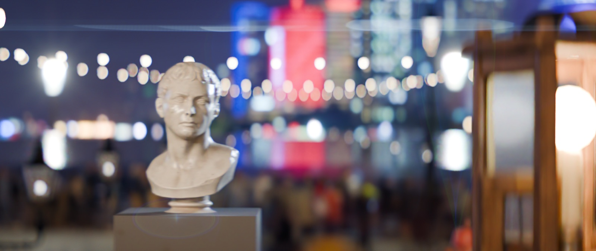
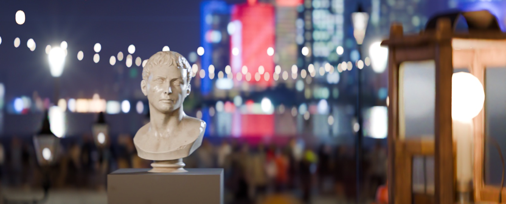
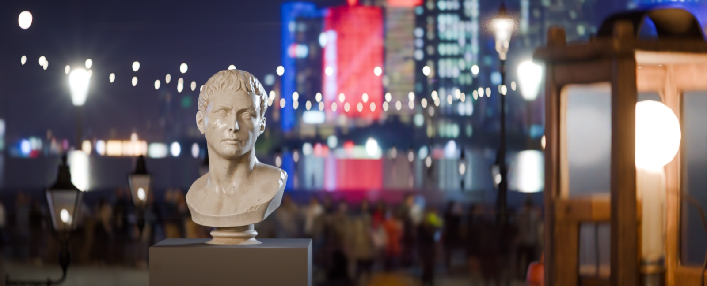

# BlenderLens — Panavision-style anamorphic lenses for Blender / Cycles

**English** | [中文](README.zh-CN.md)

BlenderLens simulates anamorphic cinema lenses in Blender using **real lens prescriptions from published patents, ray-traced surface by surface**. Every effect is computed from the prescription — none of it is a filter:
- vertically oval bokeh, cat-eye vignetting at the edges, mumps (squeeze change with focus), horizontal distortion;
- continuous-wavelength dispersion;
- horizontal streaks and ghost flares.

| C-style · 100 mm · f/2.3 | E-style · 100 mm · f/2.8 | G-style · 100 mm · f/3 |
|---|---|---|
|  |  |  |

| Neil 2× modern anamorphic · 100 mm · f/3 (0.6) | Panavision rear 1.34×, tele end · 100 mm · f/4.1 |
|---|---|
|  |  |

Same real 3D scene (Poly Haven CC0 models and HDRI), same focal length, same camera position; 768 spp + OIDN, with the forward-traced flare pass. The last two were rendered with the GPU path (M2 Max, about 3–5 minutes per 720p frame).

> Panavision has never published the production prescriptions of its C / E / G / T / Primo anamorphic series. The C / E / G presets combine **public patents of the same era and construction** with look parameters set from Panavision's published specs — they are **not replicas**. The only public Panavision anamorphic prescription, US 7,085,066 (a rear 1.34× anamorphic group), is included as-is in two presets.

**At a glance**
- 8 presets: three Panavision-style front anamorphics, the real Panavision rear 1.34× at both zoom ends, and a modern 2× by Iain Neil (Sirui patent) at 50 / 65 / 85 mm.
- Cycles OSL custom camera (CPU / OptiX) plus a **GPU path for Apple Metal** (about 19× faster than CPU, 57× faster than 0.4).
- Catalog-accurate glass dispersion (Ohara / Schott), single-layer or broadband multilayer coatings, Auto Panatar-style mumps correction.
- Deterministic forward-traced flares, diffraction starbursts, ISO 9358-calibrated veiling glare.
- Metre-scale production scenes, native 16:9 gates, a Python API, multi-machine frame rendering.
- **AI-native**: a self-describing API, a JSON command line, tiered tests with a metric baseline, and `AGENTS.md`.

---

## What's new in 0.8.8: full-frame versions

- **Every lens now has a full-frame version**: `bl.build(..., format="FF")`, the panel's Build Lens (Full Frame) menu, or `--format FF` on the command line. The presets were all designed for Super 35; the full-frame version is the same design scaled up as a whole (focal length × 1.29–1.52), so coverage, vignetting, distortion, bokeh shape and flares match the original point for point, with shallower depth of field at the same f-number. For example: C-style 64.5 mm, Neil 65 → 87.6 mm, Laowa 39.6 mm, Panavision 1.34× 31.3–100.8 mm.
- **Fix**: when C / E / G were rescaled with `focal_mm`, the mumps compensation at close focus was not rescaled with them (the squeeze drifted); it now matches the original design at every focal length.
- **Slightly faster exclude pass**: the empty frame renders in a temporary scene that holds only the camera.

## Fixed in 0.8.7: the rain layer no longer darkens the frame

- **`BL_Exclude` alpha**: in 0.8.5 / 0.8.6 the exclude layer's alpha also carried lens vignetting and a sample-clamping bias, so `BL_Final` was darkened where there was no rain (about 5–8% in the centre, more in the corners). Alpha is now divided by the transparency of an empty frame, so pixels without rain have alpha exactly 0 and `BL_Final` = scene + rain + flare. For frames already rendered, the rain colour is correct: composite additively, `Combined + BL_Exclude.rgb + BL_Flare + BL_Veil`.
- **Cheaper exclude pass**: it renders only Combined; optional `exclude_spp=` / `exclude_bounces=` (`blcli.py shot --exclude-spp`), off by default.

## What's new in 0.8.6: wide anamorphic (MessyRoom Day 5)

- **Laowa-style 2× wide 29 mm**, a real modern 2× wide anamorphic from CN 112285889 B (cylinders in the middle, not a front attachment). Scaled to a 21–28 mm framing on a 16:9 native gate, it has about −6% edge distortion against −58% for the C-style, and vertical lines bend 17–43 px at 4K against 101 px.
- **Coverage and distortion report**: `bl.coverage(cam)` / `bl.lens_info(cam, coverage=True)` / `blcli.py info --coverage` give the image circle versus the gate diagonal, corner relative illumination (same estimator as the render, within 0.02), horizontal and vertical distortion, the 4K bow of a vertical line at the frame edge, and current versus maximum covered field.
- **Faster without any quality loss**: tighter pupil sampling boxes (about 10% more useful samples, still unbiased), 2.2× faster motion-vector projection, 5× faster hole filling, BVH ray casts for reflection vectors, exact surface intersections in the flare tracer. 4K post-processing 17 → 12 s per frame.
- **Build warnings**: `bl.build` now warns (console, `lens_info`, `diagnose`) when the scaled lens cannot cover the gate instead of silently producing a porthole.

## What's new in 0.8.5: a rainy convenience store (MessyRoom Day 5)

- **Vectors and depth through glass**: shop windows, doors and fridge doors (Principled transmission ≥ 0.9 and roughness ≤ 0.1, Glass BSDF, or `bl_pass_through`) no longer give everything behind them the glass's motion. `BL_Vector` / `Depth` take the first non-transmissive hit; the glass itself goes to `BL_VectorSurface` / `BL_DepthSurface`; confidence behind glass drops by the reflection share.
- **Exclude layer for rain and particles**: `exclude_collections=["FX_rain"]` renders those collections into a separate premultiplied `BL_Exclude` (occluded by the scene). Vectors, flicker checks and temporal denoising work on the rain-free scene, and the rain is laid back over unchanged.
- **Several shots in one .blend**: `bl.render_sequence([...])` / `bl.shots_from_markers()` / `blcli.py sequence`, with a different focal length per shot, in one process. `render_shot` no longer overwrites the scene's render settings when it builds a lens.
- **Exposure keyframes respected**: `exposure="pinhole"` / `"pinhole_centre"` multiply the existing `film_exposure` curve.
- **Focus tracking**: `bl.focus_track(cam, target, frames, rack=[(frame, target), …])`.
- **Reflection motion vectors**: on flat reflectors (wet streets, puddles) the reflected image gets its own vectors (`BL_VectorReflection`, `BL_ReflectionShare`), used automatically where the reflection dominates.

## What's new in 0.8.4: moving shots and temporal stability (MessyRoom's feedback after the Day 4 film)

- **Smaller, lighter multilayer output**: `passes="temporal"` writes only what temporal denoising needs (Combined, Noisy, Volume, denoising albedo / specular / normal / roughness / depth, Depth, plus the BL layers); colour layers half + DWAB, data layers float32 + ZIP (`exr_codec`, `half_color`). Unrequested passes are switched off during the render, and post-processing streams layer by layer. 4K test frame: 555 MB → 97 MB.
- **Flicker under real camera motion**: `bl.temporal_check(..., mode="moving")` renders the real move, aligns t−1 to t with `BL_Vector`, and reports the residual plus a speed histogram and flicker per speed band.
- **Vector confidence**: a new `BL_VectorConfidence` layer (occlusion / disocclusion, depth edges, emitter halos, mirrors, speed); sky / environment pixels now get rotation vectors; fixed a Cryptomatte hash bug that left ~1 in 128 objects without object motion.
- **Temporal denoising**: `bl.temporal_denoise(in_dir, out_dir, frames)` — motion-compensated averaging weighted by vector confidence and a forward–backward check, with flare and veil added back untouched; writes a stable `BL_Final` and a frames-used map.
- **One call per shot**: `bl.render_shot(source_camera, frames, out_dir, preset, passes, spp)` / `blcli.py shot` — follows the source camera (focus and f-stop too), resumes, waits when memory is low, and logs time and memory per frame.
- **Flare is now stable in video**: the diffraction starburst was point-sampled and jumped ±25% in energy with sub-pixel motion; it is now integrated per pixel (0.3%). Forward ghost tracing is 5–6× faster.

## What's new in 0.8.3: production output (requests from the MessyRoom film)

- **Multilayer EXR with every pass** (`bl.render_still(path, passes="all")`, `bl.render_frames(..., passes="all")`): all view-layer passes are kept; Lateral in Post is applied identically to every colour pass (light groups still sum to Combined), data passes are untouched; the flare and veiling glare are separate layers (`BL_Flare`, `BL_Veil`, `BL_Final`).
- **`BL_Vector` motion vectors** computed through the real lens (Cycles' own Vector pass is meaningless for custom cameras); Cycles convention, verified to 0.2 px against measured motion. Depth / Position holes (Cycles writes them from sample 0 only, which a real lens often vignettes) are filled.
- **Focus helpers**: `bl.focus_on(cam, object | point | (u, v))`, `bl.focus_pull(cam, A, B, start, end)`, `bl.dof_range(cam, coc_px)`, `bl.stop_for(cam, near_m, far_m)`, and a `diagnose()` warning when the subject is outside the sharp range.
- **Flicker check**: `bl.temporal_check(scene, frame, n, variants=[...])` locks the camera, lets time run, and reports frame-to-frame differences (whole frame, brightest 2%, p99) plus a heatmap, with variants compared as a percentage.
- Render Region works with Lateral in Post; 4K memory baseline documented in HANDOFF; lateral-colour post is ~7× faster.

## What's new in 0.8.2: Blender 5.3 compatibility

- **Shared wavelength with 5.3 dispersive glass (GPU)**: Blender 5.3 added dispersion to the Principled BSDF, sampling one wavelength per path. Previously our lens and such glass each sampled their own wavelength and weighted the colour twice — a white sky seen through dispersive glass turned visibly yellow (14% tint). The GPU path now gives both the same random number and mapping, so they share one wavelength (tint 0.2%). Scenes without dispersive materials keep the lower-noise 0.8 sampler. The CPU / OSL path can't do this; `bl.diagnose()` warns and suggests fixes.
- **Working colour space**: lens dispersion colours now follow the scene's working colour space (e.g. ACEScg) on GPU and CPU.
- **Kernel patch drift check**: `tests/test_kernel_patch.py` (quick tier) verifies all GPU patch sites against the installed Blender and says exactly which one changed after an upgrade.

## What's new in 0.8.1: AI-native

AI agents (and scripts) can now use, test and improve BlenderLens without looking at the UI:
- **Self-describing API**: `bl.describe()` (the schema of every setting, read directly from Blender's property definitions), `bl.state()`, validated `bl.configure()`, `bl.diagnose()` (problems plus an executable fix), `bl.preview()`, `bl.contact_sheet()` (A/B comparison images).
- **Command line** `tools/blcli.py`: `presets` / `info` (optical numbers without starting Blender) / `describe` / `render` (built-in demo scene; `--variants` makes a comparison sheet) / `diagnose` / `test`. Every command prints JSON.
- **Tiered tests** `tests/run.py quick | standard | full`: parallel, JSON report (`renders/test_report.json`), metric baseline (`tests/baseline.json`) that catches results getting worse while tests still pass.
- **`AGENTS.md`**: code map, invariants that must not break, release steps and known pitfalls, for an AI taking over the project.

## What's new in 0.8

From the 0.8 "accuracy and sampling" milestone in [`blenderlens/research/ROADMAP.md`](blenderlens/research/ROADMAP.md):
- **Mumps correction (C / E / G styles)**: a first-order equivalent of the Auto Panatar compensator (Panavision 1958; Wallin's counter-rotating cylinder pair), coupled to the focus ring.
  - On by default: the squeeze at close focus equals the squeeze at infinity (C 2.011, E/G 2.094), consistent with the ARRI Master Anamorphic data sheet (1.97–2.01× at close focus).
  - With correction, focus breathing is mostly vertical (E: −6% horizontal, −32% vertical), matching Panavision's description of the E series ("vertical focus breathing"); background bokeh becomes the classic 1.9–2.3 tall oval.
  - Slider at 0 = uncorrected 1950s CinemaScope behaviour (C drops to 1.69× at close focus — "fat faces"). CPU, GPU and Geometry paths agree.
- **Multilayer coatings**: characteristic-matrix (Abelès) method; single-layer MgF₂ or a 3-layer quarter–half–quarter broadband stack (the layer next to the glass is matched to each surface's glass). Broadband ghosts are about an order of magnitude weaker and shift to magenta / amber. Neil and Panavision rear presets default to broadband. CPU vs GPU ghost energy differs by 0.7%.
- **Stratified wavelength sampling on GPU**: the wavelength uses Cycles' time dimension (the same 3D Sobol point as the pupil sample). 2.1–2.7× less chroma noise at equal samples (worth about 4.5–7× more samples), same mean colour (0.04%). Falls back automatically when motion blur is on.
- **Denser pupil sampling tables**: the fraction of useful samples rises from about 0.54 to 0.62–0.74 on average, at no per-sample cost; tables for the presets ship with the extension, so building a lens no longer waits.
- **Veiling glare calibrated to ISO 9358**: the preset value is exactly the veiling glare index measured by a synthetic test (black spot in a white field, error < 1%); FFT wrap-around removed (light on the right no longer leaks to the left); 0.6 s at 4K. In 0.7 the measured index was only about 1/4 of the setting.
- **Geometry mode gets an iris**: Geometry mode previously had no aperture mesh — only the 1.4× exit-pupil sampling disc limited the light, so f-number and blades had almost no effect. It now has an iris that moves with focus and is rebuilt when f-number or blades change. Mesh normals now use float "free normals" and avoid Cycles' bias on zero components when it compresses normals.
- **External-data regression tests** `tests/test_reference.py`: close-focus distance, close-focus squeeze, bokeh shape (front oval / rear near-round), breathing direction — each checked against manufacturer data or literature.

## What's new in 0.7

- **Camera-side ghosts on GPU**: Ghosts / Flare now renders on Metal (0.6% energy difference vs CPU, 19× faster).
- **Schott catalog**: the Isco glasses in E/G use Schott catalog curves and pass exactly through the d / C / F lines given in the patent (SF11 index corrected by 0.007 at the violet end).
- **Neil field curvature study**: the model's best-focus surface matches the curved image surface specified in the patent; on a flat sensor the 4K corners blur by about 6–12 px — a soft corner inherent to the design.
- `bl.follow_camera` (0.6.1): follows a scene camera and bakes keyframes, preserving camera motion blur.

## What's new in 0.6

- **Three Neil 2× modern anamorphic presets**:
  - read digit by digit from the Chinese grant's tables; paraxial focal lengths 49.998 / 65.028 / 85.012 mm (patent 50 / 65 / 85), back focus within 0.1 mm of the printed values;
  - internal focus with G1b: one degree of freedom focuses both axes.
- **Catalog dispersion**: Ohara glasses in the Panavision and Neil presets use catalog formulas (refractiveindex.info, CC0), error ≤ 2.6×10⁻⁵ over 400–700 nm. The old two-term approximation was off by up to 8.7×10⁻³ at the violet end for heavy flints, misplacing purple fringes.
- **Diffraction starbursts**: Fraunhofer diffraction of the iris polygon, computed per R/G/B and per-axis numerical aperture — anamorphic starbursts are stretched.
- **Veiling glare**: energy-conserving long-tail scatter, using typical ISO 9358 indices for each lens era / coating.
- **GPU ray differentials**: texture filtering matches the CPU / OSL version.

## 1. Installation

Requirements: Blender **5.0 or newer**, no third-party Python packages. Developed and tested on macOS / Apple M2 Max / Blender 5.3, with an independent re-test on an M4 Max; Windows and Linux are untested.

1. Download [`dist/blenderlens-0.8.8.zip`](dist/blenderlens-0.8.8.zip) from this repository.
2. Blender → Edit → Preferences → **Get Extensions** → ⌄ (top right) → **Install from Disk…** → choose the zip.
   Or from the command line:

   ```bash
   blender --command extension install-file -r user_default -e blenderlens-0.8.8.zip
   ```

3. Press **N** in the 3D Viewport; a **BlenderLens** tab appears.

Build the package from source:

```bash
blender --command extension build --source-dir blenderlens --output-dir dist
```

## 2. Quick start (UI)

1. **Build Lens** → pick a lens from the drop-down. The add-on builds the camera and the whole lens, makes it the scene camera, switches rendering to Cycles, and sets the output resolution for the desqueeze ratio.
   Press **F9** (or open the operator panel at the bottom left) to change:
   - **Vertical Focal Length**: scale the lens to this vertical focal length; 0 = native. 100 mm is the common focal length at which all presets are physically valid.
   - **Gate**:
     - Full Aperture: the prescription's original gate.
     - 2.39 Extraction / 16:9 Extraction: cropped from the original gate.
     - **16:9 Native (Full Circle)**: native 16:9 without cropping, using the whole image circle.
     - Custom: enter width and height.
   - **Scene Units**: Auto by default. Scenes that already have content (e.g. metre-scale production scenes) keep their units; empty scenes switch to millimetres. Inside the lens everything is millimetres; the two differ only by a scale factor.
2. Move and rotate `BL_Camera` like any camera: local −Z is the view direction. Don't touch its child objects — the add-on moves the lens groups when focusing.
3. Settings in the panel (or Properties → Camera Data → BlenderLens):
   - **Focus Distance**: measured from the image plane; 0 = infinity; can be keyframed.
   - **Mumps Correction** (C / E / G styles): 0–1, default 1.
   - **f-Number**, **Blades**: aperture and blade count; 0 = round.
   - **Dispersion / Dispersion Mode**:
     - Full: traces each sample at its own wavelength; both lateral and longitudinal colour.
     - Lateral in Post: dispersion off while rendering; lateral fringes are added exactly from the prescription's maps on output — about 45× less chroma noise.
     - Off: no dispersion.
   - **Coating**: Single MgF₂ or Broadband 3-layer, and the outer-layer thickness.
   - **Mode**: Analytic (everyday use) / Geometry (Cycles traces through real lens meshes, for verification or to see reflections).
4. Render normally (F12), or use **Render with Flare**: renders, then adds forward-traced streaks and ghosts.
   - First select a small emissive object (e.g. a small glowing sphere where a bulb is) and click **Mark Flare Source**.
   - Flare colour (physical coating colour / light colour / amber / custom) and intensity are in the panel.

## 3. GPU rendering (Mac Metal)

Cycles' native OSL custom camera only runs on CPU and NVIDIA OptiX; on Metal it renders black. Since 0.5 the add-on provides a **GPU path**:
- the same surface-by-surface tracer is compiled into Cycles' runtime-compiled GPU kernel;
- the kernel source copy lives in the extension's own user directory — **Blender itself is not modified**.

- UI: BlenderLens panel → **Enable GPU Path**, then set the Cycles device to GPU (Metal).
- It must be enabled **before the first GPU render** after starting Blender. The first kernel compile takes about 2 minutes; it is cached afterwards.
- If the path isn't enabled, the Blender version doesn't match the patch, or Geometry mode is on, rendering switches back to CPU automatically and the console says why — never a black frame.
- **Remove** in the panel deletes the kernel copy; after a restart everything is back to stock.

Measured (960×540, 256 spp, no denoising):

| | M2 Max · synthetic benchmark | M4 Max · real night-scene frame (MessyRoom re-test) |
|---|---|---|
| 0.4 CPU | 69.7 s | 119 s |
| 0.5 CPU | 22.9 s | 72 s |
| **0.5 GPU** | **1.23 s** | **19 s** |

- GPU vs the CPU / OSL reference: mean brightness differs by 0.001%, overall shift 0.000 px.
- One 4K frame (GPU, Lateral in Post, 16:9 Native, 256 spp + OIDN) takes about 3 minutes on an M4 Max.

## 4. Python and the command line

**AI-native API (0.8.1)** — discover, configure, check and preview everything without the UI:

```python
import blenderlens.api as bl
info = bl.describe()          # version, presets (focal length / squeeze / close focus), schema of every setting (type / range / options / description), API signatures
cam = bl.build("c_series_style.json", units="SCENE")
bl.configure(cam, focus_m=3, f_number=2.8, coating_type="BROADBAND", mumps_correction=1.0)   # validates first; on error raises ValueError listing valid values and changes nothing
print(bl.state(cam))          # all settings + optics + render settings + GPU status (JSON-serialisable)
print(bl.diagnose())          # list of issues: level / code / message / fix
bl.preview("//p.png", quality="draft")                       # fast low-res render + image statistics (settings restored afterwards)
bl.contact_sheet("//ab.png", [dict(f_number=2.3), dict(f_number=8)])   # several settings side by side (A/B)
```

Command line (in the source tree, prints JSON; see `AGENTS.md`):

```bash
python3 tools/blcli.py info c_series_style
```

```bash
python3 tools/blcli.py render --preset c_series_style --focus-m 3 --gpu --variants '[{"f_number":2.3},{"f_number":8}]' --out renders/cli/ab.png
```

Once the extension is enabled, scripts use the stable entry point directly (no need to know the install repository name). Distances are always in metres:

```python
import math
import blenderlens.api as bl

bl.enable_gpu()                                    # Mac: enable the GPU path (before the first GPU render)
cam = bl.build("c_series_style.json",              # preset file name, or any prescription JSON path
               focal_mm=40, gate="16:9_NATIVE", units="SCENE", height=2160)
cam.location = (0.0, -6.0, 1.4)
cam.rotation_euler = (math.radians(90), 0, 0)
bl.set_focus(cam, metres=8.5)
bl.set_stop(cam, 2.8)
bl.set_mumps_correction(cam, 1.0)                       # 0.8: mumps correction 0–1 (C / E / G styles; default 1)
cam.data.blenderlens.coating_type = 'BROADBAND'         # 0.8: coating 'SINGLE' / 'BROADBAND'
cam.data.blenderlens.dispersion_mode = 'LATERAL_POST'

print(bl.lens_info(cam))                           # focal lengths, squeeze, gate, unit conversion…
print(bl.exposure_vs_pinhole(cam))                 # exposure difference vs an ordinary camera (EV)
bl.render_still("//shot.exr", flare=True)          # render + add-on post (lateral colour, flares)
```

Render a whole shot in the background (focus and f-number keyframes work on GPU too):

```bash
blender -b shot.blend --python-expr "import blenderlens.api as bl; bl.enable_gpu(); bl.render_frames(frames=range(1, 145), out_dir='/shared/shot010')"
```

Follow an existing scene camera (keeps camera motion blur):

```python
bl.follow_camera(cam, bpy.data.objects["ShotCam"], 1, 144, substeps=2)   # bakes location / rotation / focus distance as keyframes
```

`render_frames` is:
- **deterministic**: seed = seed + frame number, so a frame renders identically on any machine;
- **resumable**: writes `.partial` and renames when done; existing frames are skipped;
- **multi-machine**: run the same command on two machines against one shared folder and `.lock` files split the frames automatically.

Pure optics (no Blender needed): add the repository root to `sys.path`, then:

```python
import blenderlens.optics as O
rx = O.load(O.PRESCRIPTION_DIR + "/e_series_style.json")
O.squeeze_at(rx, 2500.0)                 # squeeze when focused at 2.5 m
O.bokeh_aspect(rx, 1200.0, 20000.0)      # bokeh aspect ratio (desqueezed)
```

The complete reference (every parameter, FAQ, known limitations) is [`blenderlens/HANDOFF.md`](blenderlens/HANDOFF.md) (Chinese).

## 5. Lens presets

| Preset | Optical source | Focal length · aperture · close focus | Squeeze ∞ → close focus | Panavision published spec used |
|---|---|---|---|---|
| **C-style (1968)** | Front 2×: [US 2,944,464](https://patents.google.com/patent/US2944464) (Rosin / Scanoptic 1957) + prime [US 4,234,242](https://patents.google.com/patent/US4234242A) (Nikon f/2 double Gauss) | vertical 50 mm · f/2.3 · 0.76 m | 2.011 → 2.011 (corrected, default); uncorrected 1.687 (−16%) | C Series 50 mm T2.3, close focus 76.2 cm, "a pronounced anamorphic flare" |
| **E-style 135 mm (1980s)** | Front 2.09×: [US 5,184,880](https://patents.google.com/patent/US5184880A/en) embodiment 3 (Isco 1990, separately corrected axes, cam focus) + the same prime | vertical 131 mm · f/2.8 · 1.14 m | 2.094 → 2.094 (corrected, default); uncorrected 1.632 (−22%) | E Series 135 mm T2.8, close focus 114.3 cm, "clean blue horizontal flares… without veiling glare" |
| **G-style 100 mm (2007)** | Same optics as E-style, scaled by 0.763 | vertical 100 mm · f/3 · 0.91 m | 2.094 → 2.094 (corrected, default); uncorrected 1.652 (−21%) | G Series 100 mm T3, close focus 91.4 cm, "excellent glare resistance" |
| **Panavision rear 1.34× (real prescription)** | [US 7,085,066](https://patents.google.com/patent/US7085066B2/en) (Iain A. Neil / Panavision 2004) as published: zoom at the wide end + an 8-element rear anamorphic group (3 Y-cylinders + 5 X-cylinders), 2 aspheres | horizontal 15.8 / vertical 20.7 mm · f/3.66 · 0.48 m | 1.304 → 1.304 (no mumps) | Patent embodiment: 16:9 gate desqueezed to 2.40:1 |
| **Neil 2× modern anamorphic 50 / 65 / 85 mm (real prescription, 0.6)** | [CN 111562632 B](https://patents.google.com/patent/CN111562632B/en) (Iain A. Neil / Guangdong Sirui Optical, 2019) as published: one shared front anamorphic section (3 X-cylinders, 3 Y-cylinders, two-element G1b internal focus) + three interchangeable rear groups. **The tables in the US family member US 11,287,618 contain many misprints and cannot be used** (see `blenderlens/research/RESEARCH.md`) | vertical 50 / 65 / 85 mm · f/3 · 1.08 m | 2.06 → 1.93 (−6.6%) | Patent embodiment (not a Panavision lens; same designer as the Panavision rear group) |
| **Laowa-style 2× wide 29 mm (real prescription, 0.8.6)** | [CN 112285889 B](https://patents.google.com/patent/CN112285889B/zh) example 1 (Venus Optics / Laowa, 2020): negative front group (one element focuses) → Y-cylinder group → X-cylinder group → rear group with the stop; only nd / Vd and no apertures are published (apertures estimated and capped to real edge thicknesses) | horizontal 14.6 / vertical 29.0 mm · f/2.9 · 1.68 m | 1.99 → 1.99 (internal focus) | Patent embodiment; the wide option: covers 16:9_NATIVE from about 25 mm "framing" with −6% edge distortion |
| **Panavision rear 1.34×, tele end (real prescription)** | As above, zoom at the tele end Z4 (zoom spacings from [US 6,122,111](https://patents.google.com/patent/US6122111A/en) TABLE 1, applied to the verified Z1 table) | horizontal 50.9 / vertical 66.4 mm · f/4.1 (vertical) · 0.48 m | 1.305 → 1.305 (no mumps) | Zoom alone 49.22 mm (patent 49.2) |

- **Common focal length**: set "Vertical Focal Length" at Build to scale any preset to the same vertical focal length (squeeze, f-number and aberration character unchanged; presets with estimated apertures are re-estimated for the new field of view). The Isco attachment (E/G) exceeds its design field below about 100 mm, so 100 mm is the common focal length at which all presets are physically valid.
- Look parameters (aperture, close focus, coating thickness, flare intensity, corner pupil fraction, mumps correction) live in the `look` block of each prescription JSON. They are written to the camera at Build and can be changed in the panel afterwards; the corner pupil fraction sets the lens apertures (cat-eye strength) and requires recomputing apertures.
- Cat-eye strength (pupil transmission at 95% / 90% of the corner field, wide open, real ray trace): C 0.64, E 0.84, G 0.90, Panavision rear 0.68 (the patent's own apertures; the patent quotes about 50% relative illumination in the corners). Two stops down, C/E/G return to 1.00.
- The Isco attachment used for E/G is a telephoto design: with the f = 100 prime, the vertical half field of an S35 anamorphic frame is only about 4°. Scaled to 50 mm it would exceed its design field 2.6× with negative edge thicknesses, so these presets are 135 mm and 100 mm.
- Desqueeze ratio (output width = height × sensor aspect × desqueeze): C uses the nominal 2.0 (2.010 measured at centre); E/G use the real optical value 2.09 (nominal 2.0 would be 4.5% too narrow); Panavision rear uses 1.35, because the patent fits a full 2.40:1 frame into 16:9 and the real-traced edge angle ratio is exactly 2.401. Squeeze varies across the field (horizontal distortion): C 2.01 at centre to 2.27 at the edge, E 2.09→2.13, G 2.09→2.16, Panavision rear 1.30→1.35.
- Mumps (with correction off, compared at equal magnification, object distance = 20 × vertical focal length): C −12.9%, E/G −9.9%, Panavision rear 0 (internal focus). Since 0.8, C/E/G default to Auto Panatar-style correction (Mumps Correction = 1), so the squeeze stays constant at every distance. The Isco design has about a quarter less mumps than Rosin, but the patent's "about 4%" is relative to a mid-table reference distance (about 6 m); from infinity to 2.5 m the change is about 10%.
- The rear anamorphic group has no mumps: with the internal focus of US 6,122,111 (the first two groups move in the ratio 1 : 0.909), the zoom's intermediate image stays put, so the rear group always sees the same object–image relationship; both axes focus together and the squeeze does not change with focus. This is one of the biggest visual differences from front anamorphics.

## 6. Editing prescriptions (single source of truth) and further research

Each lens preset has exactly one prescription: `blenderlens/prescriptions/*.json` (E/G-style, Panavision rear and Neil presets are generated from patent transcriptions by `tools/build_presets.py`). The `BL_prescription.json` text block in a scene is a copy of the current lens's prescription. Any new JSON dropped into that folder appears in the Build Lens menu.

1. Edit R / d / glass / scale in the JSON.
2. `python3 tools/rebuild_apertures.py`: re-traces to estimate each surface's aperture and the stop position, and checks for edge collisions.
3. **Build** in Blender, or **Recompute Apertures**. Meshes, the OSL camera and the focus table are all regenerated from the JSON — never edit meshes or OSL by hand.

Research material ships with the extension in `blenderlens/research/` (in Chinese):
- `RESEARCH.md`: patents examined, data sources and digit-by-digit verification for each preset, our assumptions, a log of corrections;
- `ROADMAP.md`: the next steps (0.8 accuracy & sampling, 0.9 new lenses, 1.0 pipeline), each with method and acceptance criteria;
- candidate patent originals (not packaged in the extension) in `research_candidates/patents/` at the repository root;
- patent scans and full texts, glass dispersion data;
- the prescription generators and all tests.

## 7. Tests

```bash
python3 tests/run.py quick
```

```bash
python3 tests/run.py full
```

`quick` takes about 2 minutes, `standard` 15–20 minutes, `full` (including packaging and a clean install) about 30 minutes to an hour. The report goes to `renders/test_report.json` and numeric metrics are compared with `tests/baseline.json`. `tests/run_all.sh` is the same as `full`.

| Test | What it checks |
|---|---|
| `tests/bl_agent.py` (0.8.1) | AI API: describe / state / configure (including rejecting bad input without changing anything) / diagnose / preview / contact_sheet |
| `tests/test_optics.py` | Cauchy, analytic gradients, paraxial vs patent, real vs paraxial, focus solver |
| `tests/test_flare.py` | Flare pass: energy conservation, coating strength and colour, streak concentration |
| `tests/test_pupil.py` | The pupil sampling table covers every ray that can pass the lens (random field × wavelength × focus distance — the precondition for unbiasedness); spectral table white balance |
| `tests/bl_units.py` | Millimetre and metre scenes render the same; non-OptiX GPU falls back to CPU; stable API; gates |
| `tests/bl_sampling.py` | Pupil importance sampling on / off: same brightness in every region (unbiased), noise at equal spp |
| `tests/bl_convergence.py` | Noise reduction from 64 → 256 spp (ideal 2×): dispersion on / off × adaptive sampling on / off |
| `tests/test_presets.py` | Isco cam focus reproduces the patent's focus table (11 rows, ≤ 0.074 mm, ≤ 0.03%); Panavision focal lengths and aspheres; no edge collisions in any preset; mumps correction (squeeze at each level, focus, no collisions, sharpness kept) |
| `tests/bl_presets_smoke.py` | Every preset builds in Blender: meshes, normals, focus sync |
| `tests/bl_smoke.py` | Add-on registration, build, valid meshes, normal directions, focus sync |
| `tests/bl_verify_mapping.py` | Renders a scale target: image positions in both modes vs Python real ray tracing (Analytic < 1 px, Geometry < 1.5 px), correct orientation |
| `tests/bl_acceptance.py` | Quantitative acceptance of the four characteristic effects |
| `tests/test_gpu_lenspack.py` | GPU kernel header generation (all presets, valid literals); lateral colour maps (d-line residual, zero on axis, white preserved) |
| `tests/bl_gpu.py` | GPU path vs CPU / OSL: time, noise, brightness, overall shift, focus keyframes, Geometry fallback |
| `tests/bl_dispersion.py` | Fringe positions in Lateral in Post vs Full; noise of the three dispersion modes |
| `tests/bl_frames.py` | Exposure API vs measurement; render_frames skip, resume, determinism, locks |
| `tests/bl_gpu_ghosts.py` | GPU camera-side ghosts vs CPU / OSL: ghost energy, blurred per-pixel difference, time (`-- BROADBAND` tests the broadband coating) |
| `tests/test_coating.py` (0.8) | Coatings: single layer = Airy formula, textbook values (bare glass 4.26%, MgF₂ 1.26%), broadband residual reflectance, reciprocity, total internal reflection, weaker ghosts |
| `tests/test_glare.py` (0.8) | Veiling glare: the VGI measured by a synthetic ISO 9358 test equals the setting (3 resolutions × 3 values), no wrap-around, energy |
| `tests/test_reference.py` (0.8) | External data: close-focus distance, close-focus squeeze, bokeh shape, breathing direction |
| `tests/bl_spectral.py` (0.8) | GPU stratified wavelength sampling: chroma noise vs a reference image (16 / 64 / 256 spp), unbiased |
| `tests/bl_mumps.py` (0.8) | Mumps correction: aspect ratio of a disc at close focus, correction 0 / 1, CPU / GPU / Geometry agree |
| `tests/bl_follow.py` | follow_camera: sub-frame positions lie between frames, focus distance is keyframed, motion-blur streaks exist (and focus keyframes no longer break camera motion blur) |
| `tests/bl_percentage.py` | Correct post-processing sizes when resolution_percentage ≠ 100% |
| `tests/bl_bench.py` | MessyRoom synthetic benchmark (time, three noise measures; appended to bench.json) |
| `tests/install_test.sh` | Installs from the zip into a fresh user profile, renders, and runs a GPU frame using the command line from HANDOFF (simulating another machine) |

## 8. Validation record (2026-10-18 / 19, Blender 5.3 beta, M2 Max)

| Item | Result |
|---|---|
| Image mapping | 3 m scale target, 5 presets × Analytic / Geometry, against Python real chief-ray tracing: Analytic ≤ 0.8 px; Geometry ≤ 1.2 px (mostly a uniform sub-pixel shift, largest on the tele preset); orientation correct (not mirrored or flipped) |
| Geometry transmission | Red channel 0.875; estimate from 16 coated surfaces 0.866 |
| ① Vertical oval bokeh | C-style, focused at 1.2 m, point light at 20 m: desqueezed aspect ratio measured 1.450, real ray trace predicts 1.452 |
| ② Cat-eye at the edges | C-style: vignetting ratio of f/2.3 vs f/4.6 (an energy measure that cancels field-dependent spot size and cos⁴): edge 0.79 / corner 0.68 / far corner 0.64, predicted 0.77 / 0.68 / 0.66; gone two stops down |
| ③ Horizontal streak | 32–44% of ghost energy falls in a ±6 px horizontal band through the source (the band is only 3.2% of the frame). Colour: 100 nm blue-violet, 135 nm blue, uncoated neutral; shape unchanged |
| ④ Mumps | C-style squeeze (re-measured in 0.8.1, correction on by default): 2.010 at infinity and 2.008 at 1 m (both predicted 2.011). With correction off (behaviour up to 0.7): 1.759 at 1 m (predicted 1.752); close-ups about 13% too wide after desqueeze |
| Panavision prescription | 62 rows of Table I and the asphere coefficients checked line by line against the scan; glasses use Ohara catalog values (the patent only gives six-digit codes, and prints FPL53 as 438950; the catalog says 439950). Focal lengths x/y 15.817 / 20.627 (patent 15.81 / 20.60), back focus 35.80 (patent image distance 35.754), object half-field at 13.6 mm image height 42.14° (patent 42.34°), full-frame object-space aspect 2.401 (patent 2.40) |
| Isco prescription | Main table and focus table checked digit by digit against the scan; using the patent's own prime, the 11-row focus table is reproduced (cam motion ≤ 0.074 mm, squeeze ≤ 0.03%); estimated apertures within a few percent of the patent design apertures |
| Rosin / Nikon prescriptions | Checked digit by digit against the scans |
| Flare cross-check | Forward pass vs camera-side ghosts (adaptive sampling off, 8192 spp), halo/source ratio: 0.085 vs 0.078 (the latter still rising with samples); colour fractions differ by ≤ 0.03 |

### Corrections

An earlier report that "at f/2 the corner bokeh area is only 62% of the centre" was wrong. It came from thresholding spot area, which was skewed by noise and off-axis aberrations (a bright edge on one side plus a coma-like tail), and was not checked against an independent prediction. By real ray tracing, the apertures at the time clipped only about 7–14% of the pupil in the corners — a weak cat-eye. Apertures are now designed from each preset's corner pupil fraction (`look.corner_pupil_fraction`): C 0.40 / E 0.55 / G 0.75. Acceptance now uses an energy measure, checked item by item against real ray-trace predictions.

Three corrections in 0.4:
- **Panavision tele apertures**: 0.3 wrongly used beam heights at Z1, cutting 55% of the on-axis beam. It now uses the maximum clear diameter of each surface from claim 35 of US 6,122,111 (physical element sizes).
- **Common focal length scaling**: 0.3 did not scale the close-focus distance as well; scaling the Panavision wide end to 100 mm focused inside the lens.
- **Exposure reference**: for lenses with cylinders behind the stop, the paraxial exit pupil estimate was too large, making both Panavision presets 0.39 stop too dark. It is now measured and normalised at Build.

### Three findings that differ from the original design document

1. **"Bokeh aspect ≈ squeeze" is only an approximation.** For a lens that focuses by changing the spacing of its cylinder group, background bokeh desqueezes to about 1.5 and foreground bokeh to about 3.1. Renders agree with real ray tracing within 1%; this is a property of the construction. `optics.bokeh_aspect()` computes any focus / object-distance combination.
2. **Cycles thin film is wrong for IOR < 1.** The same 100 nm MgF₂ layer transmits 0.991 at IOR 1.6 (correct) but only 0.76 at IOR 1/1.6. The interface method therefore always uses IOR ≥ 1 and flips glass→air surface normals toward the image side — physically equivalent to "normal toward +Z, IOR = n_after / n_before".
3. **Ghost / Geometry modes must disable adaptive sampling.** Almost all samples in those pixels are black with an occasional very bright one; adaptive sampling stops early and underestimates ghosts by about 8×. The add-on disables it automatically in these modes.

## 9. Known limitations

- The Analytic direct path ignores Fresnel transmission loss (exposure is normalised to on-axis transmission); with ghosts on, coatings are accounted for. Geometry mode includes coating losses, but Cycles' thin film has only one layer, so broadband coatings are approximated as a single layer in Geometry mode.
- Flares: two-bounce sequential ghosts + diffraction starbursts + veiling glare; no stray light from the barrel walls, no diffraction ringing of the ghosts' own aperture shape.
- Mumps correction is a first-order equivalent of the counter-rotating cylinder pair (a single saddle-shaped compensator plate); higher-order cross terms between two separately rotating cylinders are not modelled. With correction off the plate is a plane-parallel window, adding two (coated) reflecting surfaces.
- Veiling glare indices are era-based estimates: no ISO 9358 measurement of any cinema anamorphic lens is publicly available.
- On the Panavision tele preset, Geometry mode still differs from Analytic by a uniform shift of about 0.3–0.4 px (at 270p) of unknown cause (it does not reproduce with a single spherical lens; investigation log in RESEARCH.md §5 item 14). Use Analytic for final renders.
- The patent does not give the stop's axial position; we use the midpoint of the P6–P7 gap. The 5 mm spacing between attachment and prime is our choice.
- Preset apertures use Panavision's published T-stops but are treated as geometric f-numbers in the model (a real lens at the same number is about 0.2 stop darker).
- The Panavision rear presets have no production-lens specs; close focus is the zoom patent's F3 (133 mm from object to first surface, 0.48 m from the image plane). Internal focus travel matches patent TABLE 1: F3 21.686 / 21.684 mm, F2 11.221 / 11.099 mm (1%; the two-group motion ratio uses the F2/F3 average 0.9088).
- Glasses that old patents only specify by n_d / V_d (Rosin, Nikon) use two-term Cauchy; Geometry mode uses a single d-line index.
- Only one BlenderLens lens per .blend file.
- On the CPU / OSL path the wavelength random number is still a hash (OSL cameras get only two random dimensions), and it cannot share the path wavelength with Blender 5.3 dispersive materials (`bl.diagnose()` warns); the GPU path is stratified and shares it.
- GPU path: Geometry mode still runs on CPU; only tested on Metal.
- Lateral in Post has no longitudinal colour (coloured bokeh fringes); use Full when you need it.

## 10. License and sources

- Code: GPL-3.0-or-later (see `blenderlens/blender_manifest.toml`).
- Lens prescriptions are transcribed from patents (public documents); sources and verification are in each prescription JSON's `source` field and in `blenderlens/research/RESEARCH.md`.
- The example images in this README use CC0 models and HDRIs from [Poly Haven](https://polyhaven.com). The assets are not in the repository; the example scene script `tools/real_scene.py` expects them downloaded to `assets/`.
- Panavision is a trademark of Panavision Inc. This project is not affiliated with Panavision; "C / E / G style" only means look parameters were set from its published specs.
